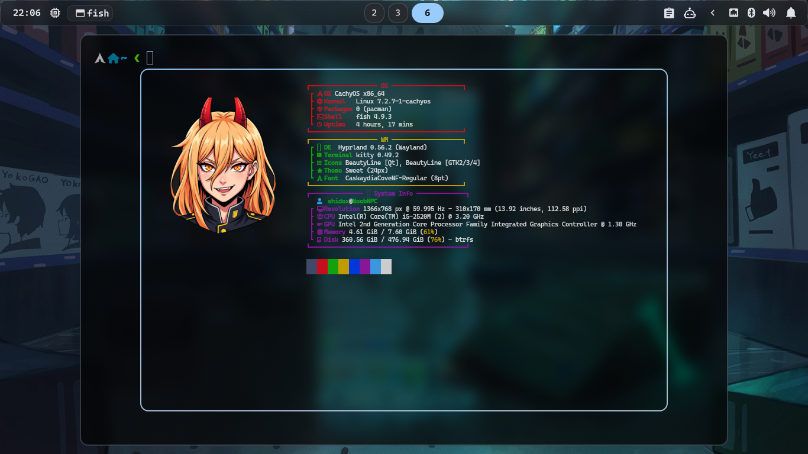
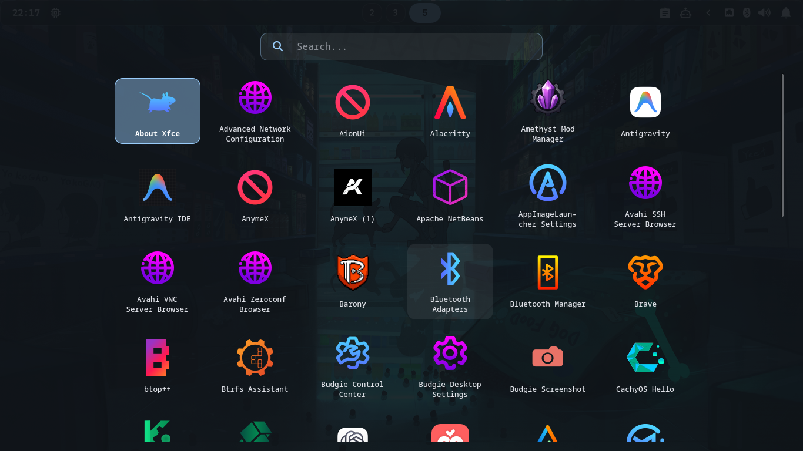
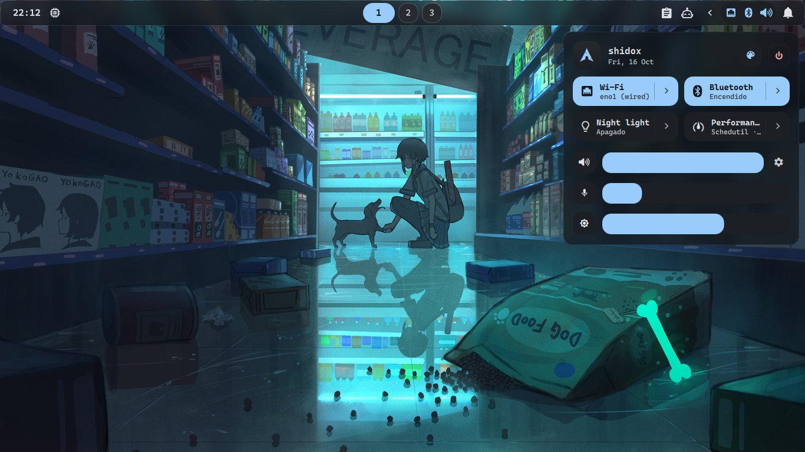
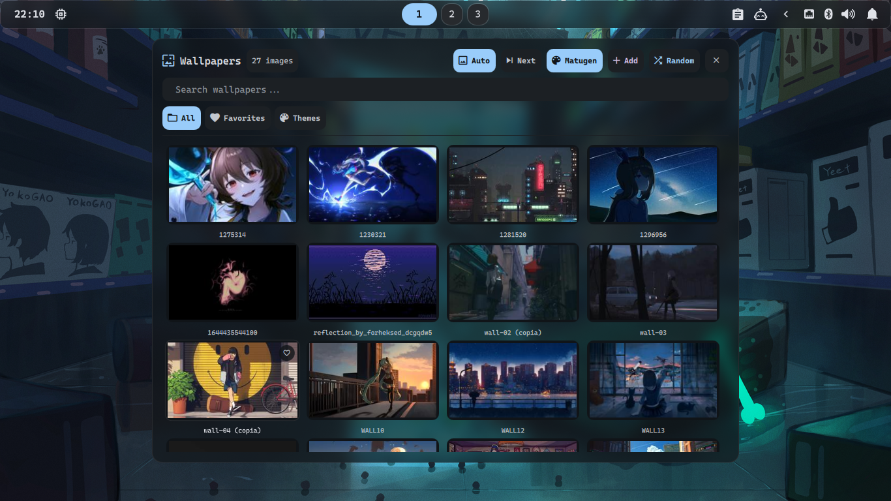

# ✨ HyprGlass Dotfiles


Una configuración minimalista, estética y **declarativa** para **Hyprland** en Arch Linux, enfocada en el estilo "Glassmorphism" y tematización dinámica con **Material You**.

<p align="center">
  
</p>

### 📸 Galería

| Glass Launcher (Rust) | Quick Settings | Wallpaper Picker |
| :---: | :---: | :---: |
|  |  |  |

## 🚀 Características

- **Instalación Declarativa**: Automatizada completamente a través de Ansible (idempotente y a prueba de errores).
- **Theming Dinámico**: Usa `Matugen` para extraer colores del fondo de pantalla (Material You) y aplicar a los bordes de Hyprland, Quickshell, terminal y notificaciones en tiempo real.
- **Compositor**: Hyprland con animaciones fluidas y blur (Vibrancy).
- **Barra / UI**: Quickshell
- **Lanzador**: Glass Launcher
- **Notificaciones**: SwayNC & Dunst.
- **Terminal**: Kitty con transparencia.
- **Shell**: ZSH + Oh My Zsh + Powerlevel10k.
- **Login Manager**: SDDM (Tema Astronaut).

## 📦 Instalación (Nueva Arquitectura)

Este entorno está optimizado para **Arch Linux** y distribuciones basadas. Ahora utilizamos **Ansible** para garantizar una instalación segura y replicable en cualquier máquina.

### 1. Clonar el repositorio

```bash
git clone https://github.com/Shidohs/HyprGlass-dotfile.git
cd HyprGlass-dotfile
```

### 2. Ejecutar el instalador

Simplemente ejecuta el script maestro. Este script comprobará si tienes `ansible` instalado (si no, lo instalará) y ejecutará el *playbook* de configuración. 

```bash
./scripts/install.sh
```

**¿Qué hace Ansible bajo el capó?**
1. Instala los paquetes oficiales de Arch desde `requirements/arch-pacman.txt`.
2. Clona el tema Astronaut en `/usr/share/sddm/themes/` y lo activa.
3. Instala Oh My Zsh, Zsh-autosuggestions, Zsh-syntax-highlighting y Powerlevel10k, y cambia tu shell por defecto.
4. Enlaza (symlink) automáticamente todo lo que está en `configs/config/` hacia tu `~/.config/`.
5. Ejecuta la primera generación de la paleta de colores dinámicos (Matugen).

> **Nota:** El script de Ansible te pedirá la contraseña `BECOME` (tu contraseña de sudo) para poder instalar paquetes y configurar SDDM.

> **Importante:** Al finalizar, reinicia tu sistema para aplicar el cambio de Shell a ZSH y cargar las variables de entorno de Wayland en SDDM.

## 🎨 Theming Dinámico (AleatoryWall)

El sistema incluye un script integrado (`~/.config/hypr/scripts/tools/AleatoryWall.sh`) para manejar los fondos de pantalla.
Al presionar el atajo o lanzarlo desde la terminal:
1. Cambia el fondo.
2. `Matugen` analiza la imagen y genera una paleta "Material You".
3. Se escribe el archivo `~/.config/hypr/matugen-colors.conf`.
4. Hyprland y la interfaz gráfica se recargan al instante con los nuevos colores para que hagan *match* perfecto con tu imagen.

## ⌨️ Atajos de Teclado Principales

Los atajos están definidos en `~/.config/hypr/config/70-keybinds.conf`.

| Atajo               | Acción                            |
| ------------------- | --------------------------------- |
| `Super + Enter`     | Abrir Terminal (Kitty)            |
| `Super + Q`         | Cerrar ventana activa             |
| `Super + E`         | Explorador de archivos (Nautilus) |
| `Super + B`         | Navegador Web (Firefox)           |
| `Super + D`         | Lanzador de aplicaciones (Glass Launcher en Rust) |
| `Super + R`         | Lanzador secundario / Menú (Fuzzel) |
| `Super + Shift + S` | Captura de pantalla (Región)      |
| `Super + L`         | Bloquear pantalla                 |
| `Super + M`         | Salir de Hyprland                 |

## 📂 Estructura del Proyecto

```
HyprGlass-dotfile/
├── ansible/         # Playbooks y Roles de instalación declarativa
├── configs/
│   ├── config/      # Archivos para ~/.config/ (hypr, quickshell, matugen...)
│   └── home/        # Archivos para el HOME (~/.zshrc, Wallpapers...)
├── launcher/        # Código fuente y binarios del Glass Launcher (Rust + GTK4 Layer Shell)
├── scripts/         # Wrapper del instalador (install.sh)
├── requirements/    # Listas de paquetes (pacman)
└── assets/          # Capturas de pantalla
```

## Créditos

- Creado y mantenido por **@Shidohs**.